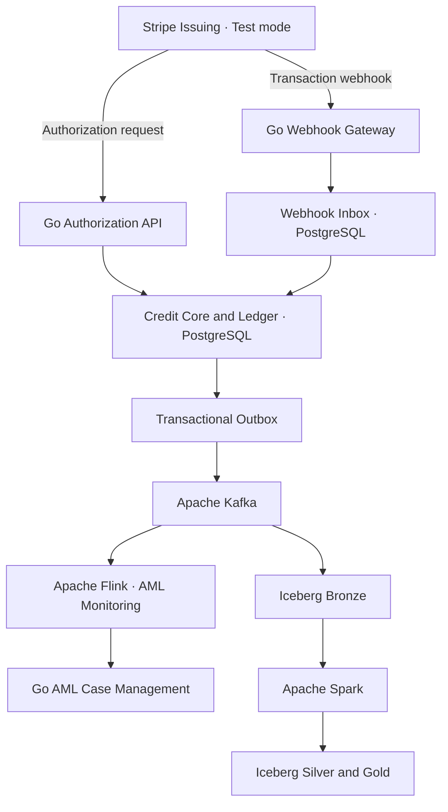

# NovaBank

NovaBank is a simulated credit card platform designed to run on a self-hosted server cluster. It uses Stripe Issuing in test mode for card issuance and card-network processing. NovaBank’s credit core handles credit limits, holds, balances, interest, statements, and repayments.

## Project status

This README describes the **target architecture**. The workflows, components, and deployment topology below are implementation goals.

## Architecture

| Component | Responsibilities |
| --- | --- |
| Card Gateway | Manages cards through Stripe, verifies webhook signatures, and maps Stripe IDs to NovaBank IDs. |
| Credit Core | Enforces credit limits, manages holds and balances, and applies versioned product policies for interest, fees, statements, and repayments. |
| Accounting Ledger | Posts balanced debit and credit entries, prevents duplicate postings, and records adjustments with references to the original entries. |
| Event Distribution | Publishes committed events to Kafka through a PostgreSQL outbox. Consumers handle replay using stable event IDs. |
| AML Monitoring and Cases | Flink detects transaction patterns in real time. Go and PostgreSQL store alerts, evidence, and review decisions. |
| Data Platform | Spark processes historical data, reconciles Stripe transactions against the ledger, and publishes end-of-day reports in Iceberg. |

## Core workflows

1. **Authorize a card purchase.** Go checks account status and available credit, then stores the decision and hold atomically. Use the Stripe authorization ID for safe retries and reconcile Stripe’s final decision after a timeout.
2. **Post a capture or refund.** The gateway durably stores each verified webhook before returning HTTP 2xx. A worker updates the transaction, balance, ledger, and outbox in one PostgreSQL transaction. Posting keys protect against duplicate charges to the ledger.
3. **Run the credit cycle.** Go workers accrue daily interest, close statements, calculate the total and minimum amounts due, allocate repayments, and update days past due. Jobs carry a business date and policy version so reruns use the intended inputs.
4. **Monitor transactions.** Flink groups events by customer or merchant and applies versioned rules using event time. Alerts include supporting transaction IDs. Case decisions are stored in PostgreSQL and can inform subsequent authorizations.
5. **Reconcile at end of day.** Spark compares Stripe Issuing transactions, Stripe balance transactions, and NovaBank ledger entries. Iceberg Bronze retains ingested events and Stripe API backfills. Silver standardizes records, and Gold holds reports and reconciliation results.

## Implementation milestones

- [ ] Deliver the authorization, capture, ledger posting, and Stripe reconciliation flow.
- [ ] Run a complete credit cycle covering interest, statement closing, repayment, and days past due.
- [ ] Publish events through Kafka and run a Flink AML rule with checkpoint recovery and alert deduplication.
- [ ] Build Spark and Iceberg pipelines for historical backfill and reproducible end-of-day reporting.

## Design reference

[NovaBank — Large-Scale Credit Card System Architecture](https://app.notion.com/p/425d6e2f1a3e81f98f0adbe3d87f63ac)
